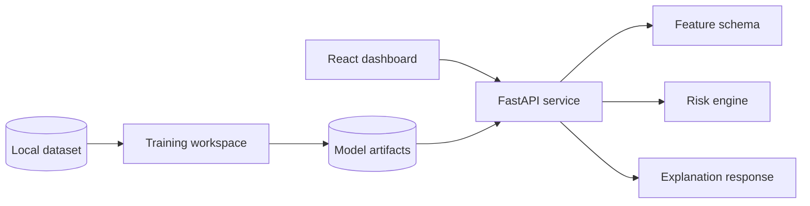

# Hriday.Ai

Hriday.Ai is a cardiovascular risk visualization dashboard for structured
clinical data. It estimates overall coronary artery disease risk and vessel-wise
risk for LAD, LCX, and RCA, then presents the result through a focused clinical
interface.

The project is organized as a full-stack application:

- FastAPI service for schema, prediction, explanation, sample cases, and what-if
  analysis
- React + Vite dashboard for patient inputs, vessel risk cards, and heart-view
  visualization
- Python ML workspace for dataset loading, leakage checks, and future model
  training
- Test suite for API health, prediction flow, and leakage rejection

## Medical disclaimer

For decision support / educational purposes only. Not a substitute for formal
diagnostic imaging.

The dashboard displays this message in the main interface and the API also
returns it with prediction responses.

## Features

- Schema-driven patient input form
- Overall CAD, LAD, LCX, and RCA risk estimates
- Confidence interval-style ranges for every target
- Sample low, medium, and high risk cases for demo flow
- Vessel-focused explanation panel
- What-if suggestions for modifiable factors
- Runtime rejection of target/leakage columns
- Responsive dashboard layout
- Clean setup scripts for Windows and Unix-like environments

## Repository layout

```text
backend/        FastAPI application and risk engine
data/           Local dataset directory; source data is not committed
docs/           Report draft, demo script, testing notes, setup notes
frontend/       React + Vite dashboard
ml/             Dataset loading, preprocessing helpers, training entry point
models/         Generated model artifacts; not committed by default
tests/          Backend and leakage tests
```

## Quick start

### Backend

```powershell
cd "C:\Users\sundr\OneDrive\Desktop\Hriday.Ai"
py -m venv .venv
.\.venv\Scripts\activate
python -m pip install --upgrade pip
pip install -r requirements.txt
uvicorn backend.app:app --reload --host 127.0.0.1 --port 8000
```

### Frontend

Open a second terminal:

```powershell
cd "C:\Users\sundr\OneDrive\Desktop\Hriday.Ai\frontend"
npm install
npm run dev
```

Open the app:

```text
http://127.0.0.1:5173
```

API base URL:

```text
http://127.0.0.1:8000
```

## Windows helper

```powershell
.\run_all.bat
```

This installs dependencies if needed, starts the FastAPI server, then starts the
frontend development server.

## Environment files

Tracked example:

```text
.env.example
frontend/.env.example
```

Local environment files:

```text
.env
frontend/.env
```

Local `.env` files are ignored by git so private machine-specific settings do
not get committed.

## API endpoints

| Method | Endpoint | Purpose |
| --- | --- | --- |
| GET | `/health` | Server status |
| GET | `/schema` | Input schema for the dashboard |
| GET | `/metrics` | Current validation metrics/status |
| GET | `/sample-patients` | Demo cases |
| POST | `/predict` | CAD/LAD/LCX/RCA risk estimates |
| POST | `/explain` | Explanation values for one target |
| POST | `/counterfactual` | What-if suggestions |

Example request:

```powershell
Invoke-RestMethod -Method Post `
  -Uri http://127.0.0.1:8000/predict `
  -ContentType "application/json" `
  -Body '{"patient":{"age":62,"sex":"male","typical_chest_pain":true}}'
```

## Data and training

The final trained model is intended to use the Z-Alizadeh Sani extension
dataset. The dataset is not stored in the repository. Place the CSV or Excel
file in `data/`, then run:

```powershell
.\.venv\Scripts\activate
python -m ml.preprocess
python -m ml.train
```

The current training entry point loads the dataset and prepares the path for the
full pipeline. The next training stage should add target mapping, cross-validated
model selection, calibration, SHAP values, saved model artifacts, and real
metrics written to `models/`.

## Leakage prevention

The project treats target-like columns as blocked inputs. These include:

```text
Cath, CAD, LAD, LCX, RCA
```

Guardrails:

- `backend/risk_engine.py` rejects these fields in runtime input.
- `ml/preprocess.py` provides `LEAKAGE_COLUMNS` and `assert_no_leakage()`.
- `tests/test_backend.py` verifies the rejection behavior.

## Architecture



## Tests

```powershell
.\.venv\Scripts\activate
pytest
```

Frontend build:

```powershell
cd frontend
npm run build
```

Current checks:

- API health check
- prediction smoke test
- direct leakage rejection
- HTTP leakage rejection
- frontend production build

## Limitations

- The current dashboard uses the included risk engine until dataset-trained
  models are added.
- Validation metrics are populated only after local model training.
- External validation is not included yet.
- RWMA is treated as a clinical hint, not anatomical lesion evidence.
- This project is not a medical device.

## Submission checklist

- Add the dataset locally in `data/`.
- Complete model training and save final artifacts in `models/`.
- Regenerate final metrics and figures.
- Capture screenshots.
- Export the report as PDF.
- Record a 3-10 minute walkthrough video.
- Deploy backend and frontend.
- Verify all links in a private browser window.
