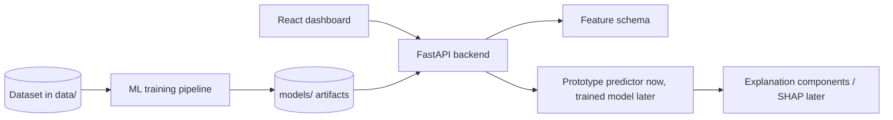

# Hriday.Ai

Hriday.Ai is a cardiovascular risk visualization prototype built for Track A:
Cardiovascular Risk Visualization & Prediction. The app takes structured
clinical inputs, estimates risk for overall CAD and the LAD, LCX, and RCA
vessels, and shows those estimates on a heart-focused dashboard.

This repository currently contains a working prototype. It is designed so the
UI and API can run before the private dataset is added, while the training path
is kept separate and honest. Once the Z-Alizadeh Sani extension dataset is put
inside `data/`, the prototype scoring layer can be replaced by leakage-safe
trained models.

## What the prototype does

- Runs a FastAPI backend with health, schema, metrics, sample-patient,
  prediction, explanation, and what-if endpoints.
- Runs a React + Vite frontend with a clinical dashboard and vessel-level risk
  map.
- Generates the input form from backend schema instead of hardcoding every field
  in the UI.
- Shows overall CAD, LAD, LCX, and RCA probabilities with confidence intervals.
- Lets the user load low, medium, and high risk demo patients.
- Shows explanation bars for the selected target.
- Includes a simple what-if panel for modifiable factors such as systolic BP,
  LDL, BMI, and fasting blood sugar.
- Rejects direct leakage columns such as `LAD`, `LCX`, `RCA`, `CAD`, and `Cath`
  if they are sent as patient inputs.

## Medical disclaimer

For decision support / educational purposes only. Not a substitute for formal
diagnostic imaging.

This line is intentionally visible in both the frontend and backend response
flow. The project is not a clinical product and should not be treated as one.

## Repository layout

```text
backend/        FastAPI app and prototype risk logic
data/           Local dataset location; ignored by git
docs/           Hindi setup notes, report drafts, figures
frontend/       React + Vite dashboard
ml/             Dataset loading and future training pipeline
models/         Generated model artifacts; ignored by git
tests/          API and leakage tests
run_all.bat     Windows helper script
run_all.sh      macOS/Linux helper script
```

## Quick start on Windows

From the project root:

```powershell
py -m venv .venv
.\.venv\Scripts\activate
python -m pip install --upgrade pip
pip install -r requirements.txt
uvicorn backend.app:app --reload --host 127.0.0.1 --port 8000
```

Open another PowerShell tab:

```powershell
cd frontend
npm install
npm run dev
```

Then open:

```text
http://127.0.0.1:5173
```

The backend API runs at:

```text
http://127.0.0.1:8000
```

## One-command helper

On Windows:

```powershell
run_all.bat
```

This creates the Python environment, installs backend dependencies, starts the
API, installs frontend packages, and starts Vite.

## API endpoints

| Method | Endpoint | Purpose |
| --- | --- | --- |
| GET | `/health` | Check whether the API is alive |
| GET | `/schema` | Return feature schema for the dynamic form |
| GET | `/metrics` | Return current validation status |
| GET | `/sample-patients` | Return demo patients |
| POST | `/predict` | Return CAD/LAD/LCX/RCA probabilities |
| POST | `/explain` | Return top explanation components for one target |
| POST | `/counterfactual` | Return illustrative what-if changes |

Example:

```powershell
Invoke-RestMethod -Method Post `
  -Uri http://127.0.0.1:8000/predict `
  -ContentType "application/json" `
  -Body '{"patient":{"age":62,"sex":"male","typical_chest_pain":true}}'
```

## Leakage prevention

The most important technical rule in this project is to avoid target leakage.
Columns such as `Cath`, `CAD`, `LAD`, `LCX`, and `RCA` are labels or label-like
fields. They must never become model inputs.

The repository has two guardrails:

- `backend/prototype_model.py` rejects these columns in runtime patient input.
- `ml/preprocess.py` exposes `LEAKAGE_COLUMNS` and `assert_no_leakage()` for the
  training pipeline.

There is also a pytest check in `tests/test_backend.py`.

## Current modeling status

The current backend uses a deterministic prototype scoring function, not a
trained clinical model. This is deliberate: no dataset file is committed to the
repository, and the app must not invent validation numbers.

The `/metrics` endpoint therefore returns zeroed placeholder values with a
clear note. Final metrics should only be generated after training on the real
dataset.

## Dataset training path

Put the Z-Alizadeh Sani extension dataset in `data/` as CSV or Excel, then run:

```powershell
.\.venv\Scripts\activate
python -m ml.preprocess
python -m ml.train
```

The next training implementation should add:

- target mapping for CAD, LAD, LCX, and RCA
- leakage-safe feature matrix creation
- repeated stratified cross-validation
- calibration and Brier score reporting
- SHAP explanations
- saved models, `feature_schema.json`, `metrics.json`, and sample patients

## Architecture



## Tests

```powershell
.\.venv\Scripts\activate
pytest
```

The current tests cover:

- API health check
- prediction smoke test
- rejection of leakage columns in patient input

## Known limitations

- The current risk values are prototype estimates, not validated model outputs.
- There is no external validation yet.
- The dataset is small, so final results must be presented with caution.
- RWMA is treated only as a clinical hint, not as anatomical lesion evidence.
- The current heart view is an SVG-based prototype, not a full Three.js heart
  mesh. It is intentionally lightweight and reliable for demo use.

## Submission checklist

- Add dataset locally in `data/`.
- Train final models and regenerate real metrics.
- Replace placeholder metrics in the dashboard.
- Capture screenshots for README/report.
- Record a 3-10 minute demo video.
- Deploy backend and frontend.
- Check all links in a private browser window.
- Confirm whether the hackathon requires the GitHub repository to be public at
  submission time.
