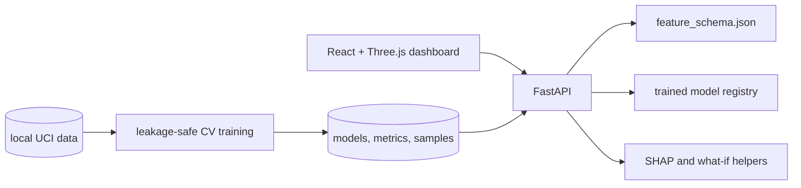

# HRIDAYA.AI

HRIDAYA.AI is an educational cardiovascular risk-visualization prototype. It
estimates angiographic CAD and LAD, LCX, and RCA stenosis labels from clinical
features, displays the estimates on a lightweight interactive heart, and
provides patient-level SHAP explanations.

> **Medical disclaimer:** For decision support / educational purposes only. Not
> a substitute for formal diagnostic imaging. This is not a medical device and
> must not guide patient care.

## Screenshots

Add project screenshots here before submission:

| Dashboard | Vessel explanation | Validation metrics |
| --- | --- | --- |
| _Screenshot pending_ | _Screenshot pending_ | _Screenshot pending_ |

## Implemented features

- Schema-driven patient form and low / intermediate / higher-risk examples
- CAD, LAD, LCX, and RCA probabilities, approximate bootstrap-model ranges, and
  low-confidence indicators
- Low-poly procedural heart fallback and configurable LAD/LCX/RCA paths;
  probability changes vessel color and a localized stenosis cue
- SHAP patient explanations, classifier-chain ablation, validation metrics,
  ROC / confusion / calibration / SHAP figures
- Illustrative what-if suggestions for selected modifiable vitals and labs
- English and Hindi copy, clinician/plain-language labels, dark/light theme,
  keyboard focus, and mobile layout
- Backend input checks and runtime rejection of target/leakage fields

## Results from the saved run

These are the real repeated-stratified-5-fold CV means and standard deviations
in [`models/metrics.json`](./models/metrics.json), generated with seed 42 on 303
single-centre patients. They are internal validation results, not external
clinical performance estimates.

| Target | Selected model | ROC-AUC | F1 | Recall |
| --- | --- | ---: | ---: | ---: |
| CAD | Soft voting | 0.923 ± 0.034 | 0.898 ± 0.034 | 0.874 ± 0.054 |
| LAD | Random forest | 0.850 ± 0.046 | 0.817 ± 0.030 | 0.826 ± 0.057 |
| LCX | Random forest | 0.729 ± 0.057 | 0.605 ± 0.056 | 0.620 ± 0.073 |
| RCA | Soft voting | 0.727 ± 0.059 | 0.575 ± 0.088 | 0.598 ± 0.126 |

LCX/RCA performance is modest and should be treated cautiously. Calibration
helped CAD, LAD, and LCX Brier scores in the saved comparison; RCA Brier score
did not improve (0.203 before vs 0.205 after). There is no external validation.

## Requirements

- Python 3.14 (the pinned Python dependencies were installed and tested in this
  workspace; other Python versions may need compatible pins)
- Node.js 20.19 or later and npm
- The UCI Z-Alizadeh Sani extension dataset at
  `data/z_alizadeh_sani_extension.xlsx`; it is intentionally not committed

## Run the app

From the repository root in PowerShell, after installing the requirements
above, the one-command Windows launcher installs Python dependencies if
needed, trains missing artifacts, and starts both development servers:

```powershell
.\run_all.bat
```

Open `http://127.0.0.1:5173`. The API listens at `http://127.0.0.1:8000`.
For Unix-like environments use `./run_all.sh`.

To retrain all artifacts from scratch:

```powershell
.\.venv\Scripts\python.exe -m ml.run_all
```

The pipeline writes the dataset summary, feature schema, models, metrics,
synthetic demo patients, and validation figures. Do not edit reported metrics
by hand.

## Manual development commands

Backend, from the repository root:

```powershell
.\.venv\Scripts\python.exe -m uvicorn backend.app:app --reload --host 127.0.0.1 --port 8000
```

Frontend, from `frontend`:

```powershell
npm ci
npm run dev
```

To point the frontend at another API, copy `frontend/.env.example` to
`frontend/.env` and set `VITE_API_URL`. The backend permits the local Vite
origins and an optional production origin via `ALLOWED_ORIGIN` (or
`FRONTEND_ORIGIN`; `ALLOWED_ORIGINS` accepts a comma-separated list).

## Deploy on Render

`render.yaml` defines the FastAPI API and Vite static site as a Render
Blueprint. Push to `main`, create a Blueprint in Render from this repository,
then set the API service's `ALLOWED_ORIGIN` to the static site's exact HTTPS
origin. Follow [`docs/RENDER_DEPLOYMENT.md`](./docs/RENDER_DEPLOYMENT.md) for
the complete deployment and live-smoke-test steps. Production configuration
is set in Render; do not commit a production `.env` file.

## API

| Method | Endpoint | Purpose |
| --- | --- | --- |
| GET | `/health` | Readiness and trained/untrained status |
| GET | `/schema` | Input fields and leakage-column names |
| GET | `/metrics` | Saved cross-validation results and figure names |
| GET | `/sample-patients` | Synthetic low / intermediate / higher-risk examples |
| GET | `/figures/{name}` | A generated validation figure |
| POST | `/predict` | Four probabilities, bootstrap-model ranges, confidence flags |
| POST | `/explain` | Up to eight patient-level SHAP contributions |
| POST | `/counterfactual` | Illustrative what-if changes; not medical advice |

Example request (feature names and categorical spelling follow `/schema`):

```powershell
Invoke-RestMethod -Method Post `
  -Uri http://127.0.0.1:8000/predict `
  -ContentType "application/json" `
  -Body '{"patient":{"Age":62,"Sex":"Male","Typical_Chest_Pain":1}}'
```

## Data, model, and leakage

The UCI extension contains 303 patients and 59 fields. `Cath` supplies the
overall CAD target; `LAD`, `LCX`, and `RCA` supply vessel targets. All four
labels are removed from every model's inputs. The raw data inspection is in
[`docs/data_summary.md`](./docs/data_summary.md); the shared blocklist and
assertions are in [`ml/leakage.py`](./ml/leakage.py). Unknown feature names,
invalid categories, and out-of-range inputs fail with an explicit 400 response.

The model compares logistic regression, random forest, and XGBoost, tunes
within training folds, chooses per-target models by nested CV ROC-AUC, checks
class-weighting / feature selection / oversampling / soft voting, and evaluates
a classifier-chain ablation. Patient ranges are the 2.5th–97.5th percentiles
of eight bootstrap-refitted model predictions; they show model spread and are
**not clinically calibrated confidence intervals**.

`Region_RWMA` is an input echo finding only. It is labelled “clinical hint, not
anatomical evidence” and is never mapped as a lesion.

## Architecture



## Tests and QA

```powershell
.\.venv\Scripts\python.exe -m pytest -q
cd frontend
npm run build
npm audit
```

Current results and remaining manual checks are recorded in
[`docs/TESTING.md`](./docs/TESTING.md).

## Limitations and ethics

- Only 303 rows from one centre; no external validation or prospective study.
- Vessel-level CV scores are modest, particularly for LCX and RCA.
- Bootstrap-model ranges describe model variation, not patient-level clinical
  uncertainty.
- RWMA is not a spatial lesion map; angiographic stenosis is not inferred from
  the visualization itself.
- Explanations and counterfactuals are educational, not causal or prescriptive.
- Not for diagnosis, treatment decisions, or clinical use.

## Extend the project

- Add or alter input metadata in `ml/preprocess.py` and regenerate
  `models/feature_schema.json`.
- Add an estimator in the training model factory and retrain with
  `python -m ml.run_all`.
- Add a vessel to `frontend/src/config/arteries.js`.

## Submission status

See [`docs/SUBMISSION_CHECKLIST.md`](./docs/SUBMISSION_CHECKLIST.md) for the
remaining owner-operated tasks. Deployment, screenshots, PDF export, video
recording/upload, GitHub publication, and hackathon submission are not included
in this workspace completion.
